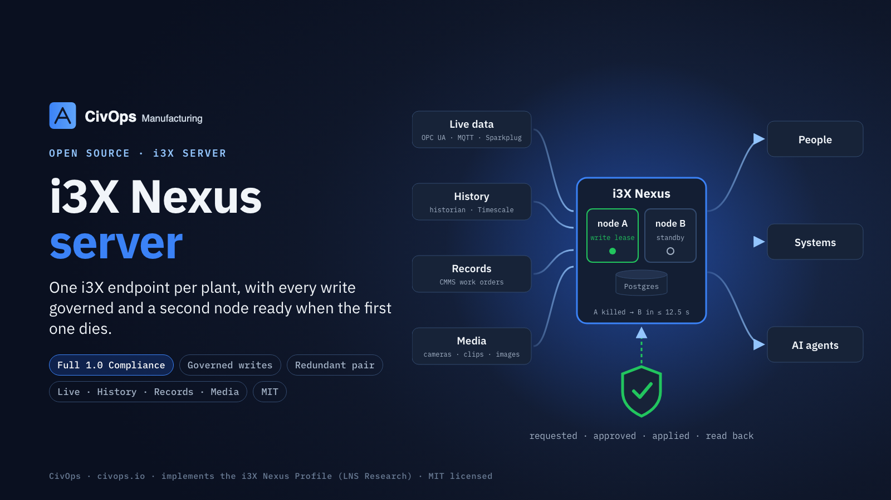

# i3X Nexus server

A server for the **i3X Nexus Profile**: one CESMII i3X 1.0 endpoint per site that serves realtime
values, history, transactional records and media (images, clips, audio, stream descriptors) in one
address space, with governed writes and priority lanes. The profile is published by LNS Research at
[github.com/LNS-Research/i3x-nexus-profile](https://github.com/LNS-Research/i3x-nexus-profile); this
repository is CivOps' implementation of it. It runs as a redundant pair over a redundant database, and
goes one level past the profile: Level 5, the **i3X Nexus Agent Extension**
([`docs/i3X-Nexus-Agent-Extension.pdf`](docs/i3X-Nexus-Agent-Extension.pdf)), from CivOps and built on the
LNS Research profile. It covers what a site needs once it runs many AI agents:

- every agent works under a **grant** from a named person: one task, the areas of the plant it covers, what it
  may do there, a request budget and an end time, and the ledger records the person behind every agent request;
- one **freeze** stops all agent writes on the site while people carry on, plus suspend, revoke and a
  **registry** of every agent's grants, outcomes and refusals;
- an **MCP server** at `/mcp`, so any MCP-speaking agent can use the plant through the same governed paths;
- **signed approvals**, bound to the exact version of the request the approver read;
- **ledger anchoring**: the ledger head is signed and exported, so a database administrator cannot rewrite
  history without it showing.



| Acceptance | Result | Evidence |
|---|---|---|
| CESMII i3X 1.0 conformance, single node | Full 1.0 Compliance in 3 consecutive runs, 53 passed, 0 failed | `docs/conformance/run-{1,2,3}.json` |
| Conformance with the governor SIGKILLed during the run | Full 1.0 Compliance at kill points 1, 3 and 5 s into the run (53–54 passed, 0 failed) | `scripts/conformance-failover.sh`, `docs/conformance/failover-run.json` |
| 20 forced governor failures under write load, lease TTL 10 s | Write RTO max 12.5 s, median 12.0 s (target ≤ 30 s); 111 writes acknowledged, 0 lost, 0 duplicated, hash chain intact | `scripts/failover-drill.ts`, `docs/level2/failover-drill.json` |
| Conformance, governed config (W1 on) | Full 1.0 Compliance in 3 consecutive runs (52–53 passed, 0 failed) | `config/example-governed.json` |
| Pair on two hosts, governor host killed | The standby took the governor role in 11 s; writes accepted while the other host was down; it rejoined as standby | — |
| Setpoint writes (W2), against a real OPC UA server | 10,000 fuzzed values: none outside the envelope accepted; ack-without-apply compensated; device refusal rejected; stale rejected; held while degraded, applied after | `tests/setpoint.test.ts` |
| Sign-in | JWTs (RS256/PS256/ES256) via JWKS; 10 forgeries and mismatches refused; key rotation; mTLS with a site CA, forged-CA certificate refused | `tests/auth.test.ts` |
| Conformance over HTTPS (trusted CA, no --insecure) | Full 1.0 Compliance, 54 passed, 0 failed, **0 warnings** | `docs/conformance/https-run.json` |
| Agent extension (Level 5) | Grants, areas, budgets, sponsor attribution, sponsor cannot approve, freeze with held requests, suspend, revoke, registry, MCP tools, signed approvals, anchors catching a rewritten ledger; also through the standby of a pair. CESMII suite with Level 5 on (grants required, signed approvals, anchoring): Full 1.0 Compliance in 3 consecutive runs, 53 passed, 0 failed | `tests/agents.test.ts`, `docs/conformance/level5-run-{1,2,3}.json` |
| Database failover (Patroni pair with an etcd witness, primary killed outright) | Writes through the server resume in 20 s in each direction; the old primary rejoins as synchronous standby by itself; ledger chain intact, no idempotency key applied twice | `scripts/verify-ledger.ts` |

One advisory warning remains in every plain-HTTP conformance run: CORE-05, plain HTTP on localhost.

All data in this repository is synthetic: `config/example-site.json` is a made-up site (Example
Manufacturing Co.), and every test builds its own.

## What it does

| Area | Behaviour | Profile |
|---|---|---|
| Realtime | OPC UA, MQTT and Sparkplug B drivers, plus a labelled simulator, feed a last-value cache. Source timestamps are kept. Staleness applies where an update period is declared (report-by-exception sources are silent when steady); a lost source reads Bad with no value. Nothing is ever substituted | NX-1…3 |
| Sparkplug B | Alias tables per node/device from BIRTH; seq gap → Uncertain until rebirth; DDEATH/NDEATH → Bad; stale NDEATH (old bdSeq) ignored; Quality property mapped. Rebirth requests are off unless declared, because they write to the plant network | NX-44, NX-61 |
| History | Event-log window in memory; PostgreSQL/TimescaleDB for owned series, deduplicated on (attribute, source time). A failed store is an error, never an empty series | NX-4 |
| Records | W0 publishing into owned namespaces (exact-match ownership, fails closed). Every write a new version in a hash-chained ledger (canonical JSON). `Idempotency-Key` makes a retried batch apply once | NX-5, NX-20, NX-30/31 |
| Media | Hash-addressed MediaItems; upload via the intake then a signed PUT verified by SHA-256; signed GET; allow-listed types; in a pair, bytes replicate node to node and a node that lacks them streams from its peer | NX-10…15 |
| Priority | Server-assigned P0–P3 lanes, shedding from P3 up with 429/503 + Retry-After; P0 never shed; SSE flushes P0 at once and conflates P1 | NX-40…46 |
| Redundancy | Two nodes over shared Postgres. Reads and subscriptions on both; writes through the governor lease holder, with epoch fencing re-checked inside every ledger transaction. A standby forwards writes with the caller's own credential and holds them through a takeover; forwarded batches always carry an idempotency key, so a governor dying mid-request cannot apply a write twice. Subscriptions live in Postgres; SSE frames carry ids and a reconnect with `Last-Event-ID` replays missed P0 events. `/info` reports mode, state (degraded below two nodes), governor and endpoints | NX-50…54 |
| Enterprise tier | Mounts site nexuses (`upstreams` in the config) over plain i3X, keeping element ids. Uplink loss → mirrored values Uncertain, last value kept. Reconnect replays the gap P0 → records → current values → history backfill. Writes to mounted elements go to the owning site with the caller's credential, and the site decides | NX-45, NX-48 |
| Governed writes (W1) | WriteRequests through `nexus:intake:W1`; authority limits as records; escalation and approver roles per profile §7.4; people approve, never the requester or an agent; conditional apply against the version requested; read-back verification with automatic compensation; rollback as a linked request; expiry; the next governor finishes an interrupted request exactly once; a 5xx from the system of record retries, only a 4xx refuses. The request's history is its hash-chained audit trail | NX-20…37 |
| Systems of record | `cmms-rest` adapter (REST work orders with If-Match); records projected read-only; a synthetic CMMS for tests and demos | NX-6, NX-22 |
| History federation | Ignition SQL historian adapter on PostgreSQL, MySQL/MariaDB or SQL Server (one dialect layer): every tag id a path ever had, across monthly partitions, quality from dataintegrity; a historian that cannot answer fails the request | NX-4 |
| Live media | MediaMTX gateway: a path per stream pulling the device, health (online, bitrate, viewers) as values, viewers authorised by a signed token the nexus checks, nobody may publish; an alarm cuts a clip stored as a MediaItem that documents it | NX-15…17 |
| Setpoints (W2) | `nexus:intake:W2`; per-attribute write envelopes (range, largest step, allowed states), checked at request and at apply, never clamped; a non-Good tag is never written; approved by a named person only; OPC UA Write with the node's own variant type; read-back, compensation; suspended while redundancy is degraded | NX-21…37, NX-53, NX-61 |
| Sign-in | OAuth 2 access tokens from the site IdP (JWKS, algorithm allow-list, iss/aud/exp/nbf), client certificates from the site CA, HTTPS; the IdP says who, the nexus decides what; forwarded writes carry a cluster-signed identity assertion | §10 FR1 |
| Security | One principal per actor, tokens stored as SHA-256, scopes, per-principal rate limit; node-to-node media fetches signed with the cluster secret | §10 |

The historian adapter's SQL Server dialect was verified against SQL Server 2022 using the same adapter code in
the standalone `i3x-ignition-historian` package. Other historian products need their own adapter.

## Run it

```bash
npm install
npx tsx scripts/principal.ts ops-console person read > principals.local.json  # wrap the line in [ ]
NEXUS_PRINCIPALS=principals.local.json npm start         # config/example-site.json, :8400/v1
npm test                                                  # cluster and dialect tests need a database (NEXUS_TEST_PG / .local/pg-url); skipped otherwise
NEXUS_NODE_ID=a NEXUS_PG_URL=… NEXUS_CLUSTER_SECRET=… NEXUS_PRINCIPALS=… npm start   # one node of a pair
npm run typecheck
scripts/conformance.sh config/example-site.json 3         # CESMII suite, 3 runs, one principal per run
scripts/conformance-failover.sh                           # suite against node B while node A (governor) is SIGKILLed
scripts/gateway-e2e-docker.sh                             # media gateway test: real MediaMTX + test-pattern camera (Linux Docker)
npx tsx scripts/failover-drill.ts 20 10000                # 20 governor kills under write load, then ledger reconciliation
```

Agent extension (Level 5):

```bash
NEXUS_AGENTS_REQUIRE_GRANT=1      # agents act only under a grant (PUT /x-nexus/agents/grants)
NEXUS_SIGNED_APPROVALS=1          # approvers sign: npx tsx scripts/sign-approval.ts key.pem "<string from GET /x-nexus/requests/{id}>"
NEXUS_ANCHOR_KEY=anchor.pem NEXUS_ANCHOR_FILE=/other/storage/anchors.jsonl   # and/or NEXUS_ANCHOR_URL
npx tsx scripts/verify-anchors.ts data/records.jsonl /other/storage/anchors.jsonl anchor.pub.pem
```

An MCP client points at `https://<nexus>/v1/mcp` with the agent's grant token as its bearer token.

The suite is not on npm. Clone `github.com/cesmii/i3X` at `1.0` and point `I3X_SUITE` at `conformance-tests/`.

`config/example-site.json` is a synthetic site (Example Manufacturing Co.). Real site configs and
principal files are git-ignored.

## Layout

```
src/i3x/wire.ts      i3X 1.0 envelopes, projection, bulk reads, history, subscriptions (pure)
src/i3x/fabric.ts    the site model + cache + records + media as one address space
src/i3x/writes.ts    the W0 write path and the media intake
src/i3x/stream.ts    SSE on a long-lived process: P0 at once, P1 conflated on a tick
src/core/            cache, history, records ledger and its anchoring, media store, auth, priority lanes
src/drivers/         simulator, OPC UA, MQTT, Sparkplug B
src/cluster/         shared schema, governor lease, shared subscriptions
src/mirror/          enterprise tier: mount a site nexus over i3X
src/governance/      authority limits, the W1 governor, system-of-record adapters, projection
src/agents/          agent grants, registry, freeze (control.ts) and the MCP server (mcp.ts)
src/history/         historian federation (Ignition SQL on Postgres, MySQL, SQL Server)
src/media/           media gateway (MediaMTX)
src/nexus.ts         wiring and the HTTP transport
```

## Notes for whoever runs this next

- CESMII's suite samples one object per type for values and writes to the first that holds one.
  Owned writable records therefore lead `/objects`, and the conformance config seeds one with `initial`.
- The wire layer folds "Bad with a value" into Uncertain. The fabric serves Bad without a value, so a lost
  source shows as lost (test `OPC UA … session loss → Bad`).
- The per-principal rate limit is real: one token across three back-to-back suite runs trips it on run 3.
- Kill the node process, not a wrapper: `npx` forwards nothing on SIGKILL and leaves the real server running.
- jsonb reorders object keys, so ledger hashes are over canonical (sorted-key) JSON.
- Kill tests on systemd units: `systemctl kill --kill-whom=all` refuses on some units; `pkill -9 -u <service user>` then `systemctl stop` is a true hard failure.
- Under Patroni, give the `nexus` database the `C` collation if the members run different C libraries, and run Patroni as a system user: systemd removes a login user's shared memory when their last session ends.
- A `pg_dump` newer than the target's `psql` emits `\restrict`; strip those two lines or restore with the newer client.

## License

MIT. See [LICENSE](LICENSE). From [CivOps](https://civops.io).
